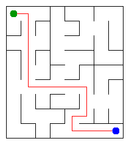

# Assignment 3. Maze Escape

Student ID: 252949
Name: Alina Sharafitdin
Group: SE2532
Maze size: 72 cells. Rows and columns are specified in data/walls.txt.

## Program output

```text
Broken: 71
Kept: 56
Last broken wall: 114
MST cost: 21903
Heaviest broken wall: 798
Path length: 17
DFS visited: 54
Dead ends: 24
Zones: 10
Largest zone: 11
Is DAG: 0
Flow stages: 7
Fastest route cost: 19
```

## Maze picture



Open output/maze.html in a browser to explore the maze.

## Questions

### Mission 0. What do find and union do, and what makes them fast?

find returns the root of the group containing a cell. union joins two
different groups and returns true; if the cells are already in the same
group, it returns false. Union by size keeps trees shallow, and path
compression makes later searches faster by connecting cells directly
to their root.

### Mission 1. Why is Broken always R*C - 1?

Initially, there are R*C separate groups. Every successful union reduces
the number of groups by one. Since the rectangular grid is connected,
exactly R*C - 1 walls must be broken to obtain one group.

### Mission 1. Why is Kept always (R-1)*(C-1)?

The grid has R*(C-1) + C*(R-1) inner walls. Subtracting the R*C - 1
broken walls gives (R-1)*(C-1) walls that remain standing.

### Mission 2. What are the MST costs from Kruskal and Prim?

Both algorithms give a total cost of 21903. Kruskal considers walls
from cheapest to most expensive and selects those joining different
components. Prim grows one tree by choosing the cheapest edge leading
to a new cell; both algorithms produce a minimum spanning tree by the
cut property.

### Mission 3. Why is there exactly one path?

The maze is connected, and breaking walls never creates a cycle because
union rejects cells already in the same component. Therefore, the open
passages form a tree. A tree has exactly one simple path between any
two cells.

### Mission 3. How did I avoid stack overflow?

DFS uses explicit arrays to store the current path and the next
direction to try. It does not use recursive method calls, so a long
path does not overflow the Java call stack. Neighbours are tried in
the required order: up, right, down, left.

### Mission 4. Why does the second pass use the reversed graph?

The first pass records the finishing order of DFS on the original
graph. The second pass processes vertices in reverse finishing order
on the reversed graph. This prevents a search from entering another
unassigned component, so each new search identifies one complete SCC.

### Mission 4. Why is the graph a DAG exactly when Zones equals n?

There are no self-loops in the input. Any directed cycle therefore
contains at least two different cells, and these cells belong to the
same SCC. Consequently, the graph has no directed cycles exactly when
every SCC contains one cell, giving n zones.

### Mission 5. Why is zone-number order sufficient?

Kosaraju numbers the zones in topological order: edges between zones
go from smaller numbers to larger numbers. Thus, all predecessors of
a zone are processed before it. This allows one forward pass to
compute the longest chain and the cheapest route.

### Mission 5. What is the cost of this pass?

Let s be the number of slides and z the number of zones. Grouping
cross-zone slides, selecting the cheapest parallel edges and computing
the routes together take O(s+z) time and O(s+z) extra space. No priority
queue is used in this mission.

## AI use

I used ChatGPT to generate implementations of the assignment algorithms,
suggest additional DSU tests, explain the code, interpret check results,
draft README answers and guide the Git workflow. I copied the suggested
code into the starter project and ran the provided checks and benchmark
on my laptop. The ready classes and examples came from the course
starter project.

## Timing

Measured on my laptop using the supplied Bench class. Each algorithm
was run five times for each maze size.

| Maze | Kruskal average, ms | Prim average, ms |
|---|---:|---:|
| 100 x 100 | 23 | 14 |
| 300 x 300 | 93 | 78 |
| 1000 x 1000 | 1793 | 3096 |

As the side length increases, the number of cells grows quadratically,
and the number of walls grows proportionally to the number of cells.
Both implementations have approximately O(n log n) time on these grids,
so runtime grows faster than the number of cells alone. Prim was faster
on the smaller mazes, while Kruskal was faster on the largest; JVM warmup,
memory allocation and garbage collection also affect the measurements.

## Complexity

n = number of cells, m = number of walls, s = number of slides,
z = number of zones. Space means auxiliary storage, excluding input.

| Algorithm | Time | Space | Assumptions |
|---|---|---|---|
| DSU find and union | O(alpha(n)) amortized per operation | O(n) for the DSU, O(1) per call | Union by size and iterative path compression; initialization is O(n) |
| Build maze in file order | O(n + m*alpha(n)) | O(n) | Includes DSU initialization and selected walls |
| Kruskal | O(n + m log(m+1) + m*alpha(n)) | O(n+m) | Sorting wall indexes and using DSU |
| Prim | O(n + m log(m+1)) | O(n+m) | Lazy priority queue containing wall indexes |
| DFS escape | O(n) | O(n) | The open maze is a tree with n-1 edges and degree at most four |
| Kosaraju | O(n+s) | O(n+s) | Forward and reverse adjacency lists and explicit stacks |
| Route in the zone graph | O(s+z) | O(s+z) | Includes grouping slides, choosing minimum parallel costs and DAG processing |

## Validation

The supplied checker reports:

```text
tiny: all 13 lines are right
small: all 13 lines are right
dag: all 13 lines are right
```

All DisjointSetTest checks pass, including the additional large-chain,
self-union and repeated-union checks.

## Run

Generate personal input:

```text
java tools/MakeVariant.java 252949 data
```

Compile and check:

```text
java tools/Check.java
```

Run on personal input after checking, to restore the personal maze picture:

```text
java -cp out Main
```

Run the benchmark:

```text
java -cp out Bench
```
